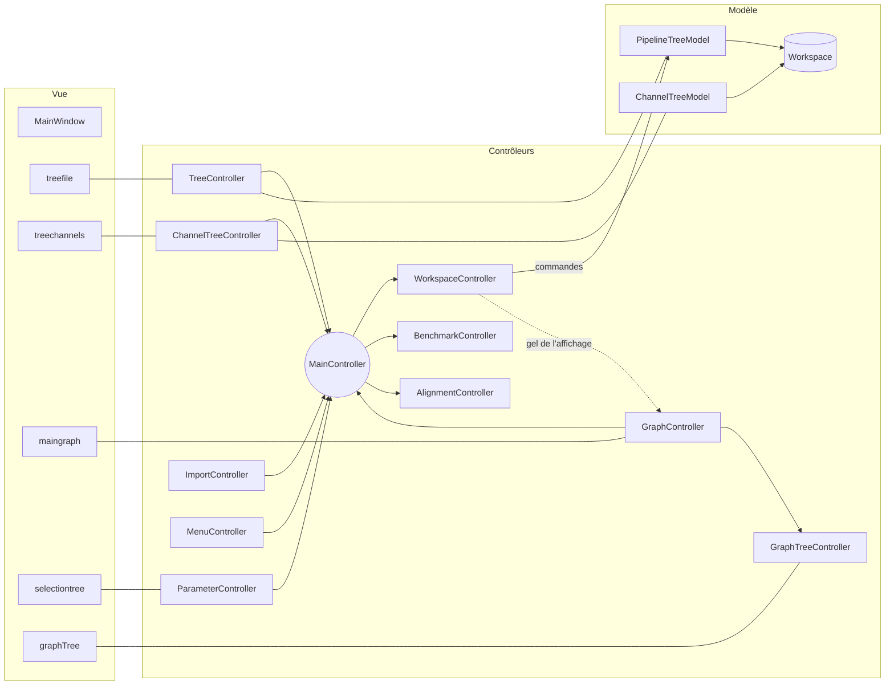
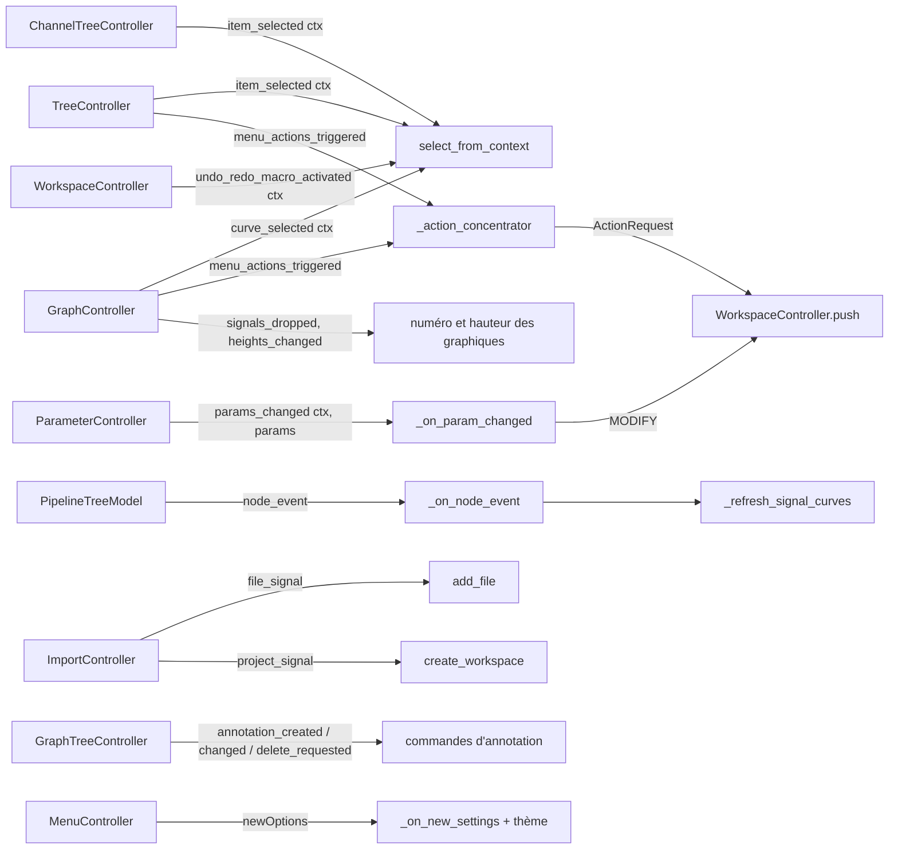

# 00 · Vue d'ensemble

GLviewer suit le patron **Modèle – Vue – Contrôleur** :

- le **modèle** contient les données et la logique de calcul, sans dépendre de l'interface (à part quelques types
  Qt simples, `QPen` par exemple) ;
- la **vue** contient les fenêtres et les widgets, chargés depuis les fichiers Qt Designer `.ui` ;
- les **contrôleurs** relient les deux : ils écoutent les signaux Qt des widgets, modifient le modèle (de
  préférence par une commande annulable) puis rafraîchissent la vue.

## Les dossiers

| Dossier | Rôle | Fichiers clés |
|---|---|---|
| [`model/`](../../model/) | Données et calculs | [base_objects.py](../../model/base_objects.py) (`Workspace`, `FileObject`, `SignalObject`, `DerivedSignalObject`), [filters/](../../model/filters/), [analysis/](../../model/analysis/), [computed.py](../../model/computed.py), [formula/](../../model/formula/), [channels.py](../../model/channels.py), [benchmark.py](../../model/benchmark.py), [annotations.py](../../model/annotations.py), modèles Qt des arbres ([tree_model.py](../../model/tree_model.py), [channel_tree_model.py](../../model/channel_tree_model.py), [tree_item.py](../../model/tree_item.py)), [txt_import.py](../../model/txt_import.py), [missing_data.py](../../model/missing_data.py) |
| [`view/`](../../view/) | Fenêtres | [main_window.py](../../view/main_window.py) (charge `MainWindow2.ui`), [detached_graph_window.py](../../view/detached_graph_window.py), [benchmark_window.py](../../view/benchmark_window.py), [custom_treeview.py](../../view/custom_treeview.py) |
| [`controller/`](../../controller/) | Orchestration | [main_controller.py](../../controller/main_controller.py), un fichier par sous-contrôleur, [commands/](../../controller/commands/) (commandes undo/redo) |
| [`ressources/`](../../ressources/) | Partagé par toutes les couches | [custom_types.py](../../ressources/custom_types.py) (énumérations `itemType`, `qSignalType`, `ActionModifier`, `fileType`), [custom_items.py](../../ressources/custom_items.py) (dataclasses `SelectionContext`, `ActionRequest`, `FileStruct`, `ThermalFitResult`…), [custom_dialogs.py](../../ressources/custom_dialogs.py) (boîtes de dialogue), [custom_parameters.py](../../ressources/custom_parameters.py) (types de paramètres pyqtgraph sur mesure), [custom_viewer_settings.py](../../ressources/custom_viewer_settings.py) (schéma des options), [theme.py](../../ressources/theme.py), [icons/](../../ressources/icons/) |
| [`tests/`](../../tests/) | Tests pytest (environ 550) | [conftest.py](../../tests/conftest.py) (fixture `ctrl` : un `MainController` complet, profil isolé) |

Point d'entrée : [main.py](../../main.py). Il crée la `QApplication`, la `MainWindow` et le `MainController`, puis
applique le thème quand les options sont lues.

## `MainController`, le chef d'orchestre

[`MainController`](../../controller/main_controller.py) crée tous les sous-contrôleurs, garde le `Workspace` courant
et connecte les signaux Qt (`_connect_tree_signals`, `_connect_graph_signals`, `_connect_param_signals`…). Les
sous-contrôleurs ne se connaissent pas entre eux : chacun émet des signaux, et le `MainController` décide de la
suite. Cette règle a deux exceptions : `GraphController` contient son `GraphTreeController`, et
`WorkspaceController` reçoit le `GraphController` pour geler l'affichage pendant une commande.

Ce qu'il fait lui-même :

- **cycle de vie du workspace** : `add_file` (fichier importé), `create_workspace` (projet ouvert),
  `_init_workspace_model` (construit le `PipelineTreeModel`), sauvegarde (`save_project`, `is_modified`, l'étoile
  `*` du titre) ;
- **sélection** : `select_from_context(ctx, source)` est le **point d'entrée unique** de toute sélection, qu'elle
  vienne de l'arbre, du graphique, de la vue « Par voie » ou d'un undo (voir
  [08 · Arbres et sélection](08-arbres-selection.md)) ;
- **actions** : `_action_concentrator` reçoit les actions des menus contextuels et les traduit en `ActionRequest`
  pour le `WorkspaceController` (voir [05 · Undo / redo](05-undo-redo.md)) ;
- **recalculs** : `_refresh_signal_curves`, `_refresh_derived` et `_refresh_computed` remettent à jour les courbes,
  les signaux dérivés et les voies calculées après une modification (voir [02 · Pipeline](02-pipeline.md)).

### Les sous-contrôleurs

| Contrôleur | Fichier | Widget piloté | Rôle |
|---|---|---|---|
| `TreeController` | [tree_controller.py](../../controller/tree_controller.py) | `view.treefile` | Arbre « Par fichier » : sélection, cases à cocher, menu contextuel |
| `ChannelTreeController` | [channel_tree_controller.py](../../controller/channel_tree_controller.py) | `view.treechannels` | Arbre « Par voie » : voies logiques, groupes, glisser-déposer |
| `GraphController` | [graph_controller.py](../../controller/graph_controller.py) | `view.maingraph` | Panneaux empilés, courbes, surbrillance, curseur souris, fenêtres détachées |
| `GraphTreeController` | [graph_option_controller.py](../../controller/graph_option_controller.py) | `view.graphTree` | Options du graphique (curseurs, outils) et annotations texte |
| `ParameterController` | [parameter_controller.py](../../controller/parameter_controller.py) | `view.selectiontree` | Construit le ParameterTree de l'objet sélectionné à partir de son `PARAMETER_SCHEMA` et émet `params_changed` |
| `CursorController` | [cursor_controller.py](../../controller/cursor_controller.py) | – | Position du curseur, accroche à la courbe sélectionnée |
| `MenuController` | [menu_controller.py](../../controller/menu_controller.py) | Menus, fenêtre Options | Options utilisateur et fichiers récents (`~/MVC_test/settings.json`) |
| `ImportController` | [import_controller.py](../../controller/import_controller.py) | Dialogues d'ouverture | Lecture des fichiers et des projets (voir [06 · Import](06-import.md)) |
| `ExportController` | [export_controller.py](../../controller/export_controller.py) | Dialogues d'enregistrement | « Save as » du projet `.json` |
| `WorkspaceController` | [workspace_controller.py](../../controller/workspace_controller.py) | – | Pile undo/redo (`QUndoStack`), macros |
| `AlignmentController` | [alignment_controller.py](../../controller/alignment_controller.py) | Bandeau sur le graphique | « Align in time… » : recalage d'un fichier dans le temps |
| `BenchmarkController` | [benchmark_controller.py](../../controller/benchmark_controller.py) | `BenchmarkWindow` | Tableau et graphique des modèles thermiques par essai |

Les classes d'appui [plot_panel.py](../../controller/plot_panel.py) (`PlotPanel`, axes, échelles par unité),
[graph_context_menu_controller.py](../../controller/graph_context_menu_controller.py) et
[tree_context_menu_controller.py](../../controller/tree_context_menu_controller.py) (menus contextuels) vivent aussi
dans `controller/`.

## Schéma des composants

## Carte des signaux Qt

Signaux reçus par le `MainController`, et ce qu'il en fait :

## Conventions à connaître

- **Identifiants** : chaque fichier, signal, filtre, analyse et annotation a un `id` (`uuid4().hex`). Les commandes et
  les `SelectionContext` désignent les nodes par leur id. La position (`index`) ne sert qu'à réinsérer un node au même
  endroit.
- **Schémas de paramètres** : chaque objet éditable (`FileObject`, `SignalObject`, chaque filtre et chaque analyse)
  déclare un `PARAMETER_SCHEMA`. Le `ParameterController` en tire le ParameterTree, et `opts_dict` fait le lien
  entre le chemin d'un paramètre dans l'arbre et sa clé (`"key"`).
- **Nodes immuables** : on ne modifie jamais un filtre ou une analyse en place. `clone_with(**params)` crée un nouveau
  node (avec un nouvel id), que la commande échange avec l'ancien. C'est ce qui rend l'undo trivial.
- **Messages et commentaires en français**, noms de code en anglais.
- Les commentaires `#!` signalent un point fragile ou un reste à nettoyer, `#?` une question ouverte.
