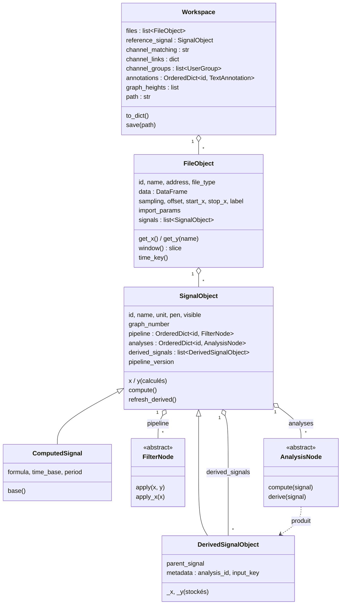

# 01 · Modèle de données

Tout se trouve dans [model/base_objects.py](../../model/base_objects.py), sauf `ComputedSignal`
([model/computed.py](../../model/computed.py)) et les nodes ([model/filters/](../../model/filters/),
[model/analysis/](../../model/analysis/)).

## Hiérarchie



## `Workspace`

Le contenu d'un projet : les fichiers chargés, plus l'état commun.

- `reference_signal` est le signal défini comme référence (clic droit > « Set as temperature ref »). Il sert aux filtres
  et aux analyses de différence.
- `channel_matching`, `channel_links` et `channel_groups` décrivent comment la vue « Par voie » regroupe les voies
  (voir [08 · Arbres et sélection](08-arbres-selection.md)).
- `annotations` contient les textes du graphique, `graph_heights` les hauteurs relatives des graphiques empilés.
- `path` est le fichier projet `.json` (`None` tant qu'il n'a jamais été enregistré).

## `FileObject`

Un fichier de mesure chargé. Il est construit à partir d'un `FileStruct`
([custom_items.py](../../ressources/custom_items.py)) rempli par l'`ImportController`.

- `data` est un `DataFrame` pandas, une colonne par voie, avec un `MultiIndex` dont le 2e niveau est le temps. Les
  données lues ne sont **jamais modifiées**.
- **L'axe des temps** vaut `offset + n × sampling`. Il est reconstruit par `_rebuild_time()` quand la période
  (`set_sampling`) ou le décalage (`set_offset`) changent. `get_raw_x()` le met en cache, en lecture seule
  (`setflags(write=False)`), parce qu'il est relu à chaque rafraîchissement (jusqu'à 1 million de points).
- **La troncature** (« Truncate left / right », `start_x` / `stop_x` en secondes) est un calque : `window()` renvoie
  la tranche d'échantillons conservés, et `get_x()` / `get_y(name)` l'appliquent. Le pipeline de chaque voie part de
  là.
- `time_key()` = (période, décalage, début et fin de la fenêtre) résume l'état de l'axe des temps. Il entre dans les
  clés d'invalidation des analyses et des voies calculées.
- `import_params` garde les réglages de l'import (séparateurs de l'assistant `.txt`, `check_table` des voies HZ,
  `channel_ids` et `channel_units` du GL). Ils servent à relire le fichier à l'ouverture du projet.
- `channel_id(name)` renvoie le numéro de voie (« CH3 ») et `channel_unit(name)` l'unité (`degC` → `°C`).

## `SignalObject`

Une voie mesurée. Ses données affichées **sont calculées** à partir des données brutes du fichier et de son pipeline
de filtres (voir [02 · Pipeline](02-pipeline.md)).

- `pipeline` et `analyses` sont des `OrderedDict` id → node. L'ordre compte : les filtres s'appliquent dans l'ordre
  du dict. On ne les modifie jamais en place : les commandes remplacent le dict entier (`od_insert`, `od_remove`,
  `od_replace` dans [custom_commands.py](../../ressources/custom_commands.py)) et incrémentent `pipeline_version`.
- `x` et `y` sont les données après filtres, `raw_x` et `raw_y` les données brutes.
- `derived_signals` contient les signaux produits par les analyses de ce signal.
- `graph_number` est le graphique empilé où la courbe est tracée (1 = celui du haut, au plus `MAX_GRAPHS` = 8).
- `is_selected`, `is_reference` et `visible` sont des drapeaux d'affichage, lus par les arbres et le graphique.

## `DerivedSignalObject`

Le résultat d'une analyse : la courbe d'un modèle, une FFT, une différence entre fichiers. Contrairement à
`SignalObject`, `x` et `y` sont **stockés** : ils n'ont pas de pipeline ni d'analyses. Ses `metadata` contiennent
`analysis_id`, l'analyse qui l'a produit, et `input_key`, l'état des données d'entrée au moment du calcul. C'est ce
qui permet de savoir s'il est périmé. Il prend l'unité et le graphique de son `parent_signal`.

## `ComputedSignal`

Une voie calculée par une formule. Elle se comporte comme une voie mesurée (filtres, analyses, vue « Par voie »),
seules ses données brutes viennent de la formule. Voir [04 · Voies calculées](04-voies-calculees.md).

## `TreeItem` et `itemType`

[model/tree_item.py](../../model/tree_item.py) contient un nœud d'arbre générique : `obj` (l'objet du modèle
affiché), `parent_item` et `children`. Son `item_type` est lu sur l'objet, et chaque classe déclare le sien :

| `itemType` ([custom_types.py](../../ressources/custom_types.py)) | Objet |
|---|---|
| `FILE` | `FileObject` |
| `RAW` | `SignalObject` (et `ComputedSignal`) |
| `FILTER` | `FilterNode` |
| `ANALYSE` | `AnalysisNode` |
| `DERIVED` | `DerivedSignalObject` |
| `CHANNEL` | `ChannelGroup` (voie logique de la vue « Par voie ») |
| `CHANNEL_GROUP` | `UserGroup` (groupe de voies logiques créé par l'utilisateur) |

`TreeItem.to_selection_context()` traduit un nœud en `SelectionContext` (voir
[08 · Arbres et sélection](08-arbres-selection.md)).

## Paramètres éditables : `PARAMETER_SCHEMA`

Chaque objet éditable déclare un dictionnaire libellé → spécification, par exemple :

```python
'Time offset': {'type': 'float', 'default': 0.0, 'suffix': 's', 'readonly': False, 'key': 'offset'}
```

- `generate_opts_dict` ([custom_struct_functions.py](../../ressources/custom_struct_functions.py)) en tire
  `opts_dict`, qui fait correspondre le chemin du paramètre dans l'arbre et sa clé `key`.
- `get_params()` / `set_params()` lisent et écrivent les valeurs par leur clé.
- Les types qui ne viennent pas de pyqtgraph (`signal`, `channel`, `cursors`) sont traités par
  `ParameterController._build_parameter_group` ([parameter_controller.py](../../controller/parameter_controller.py)).
  Les groupes sur mesure (`LinkedCursors`, `MouseCursors`…) sont dans
  [custom_parameters.py](../../ressources/custom_parameters.py).
