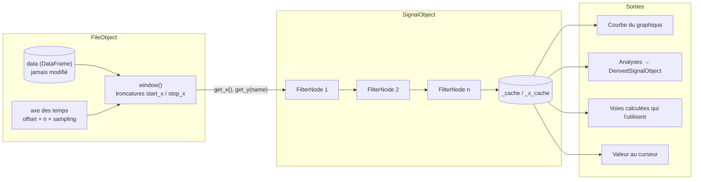
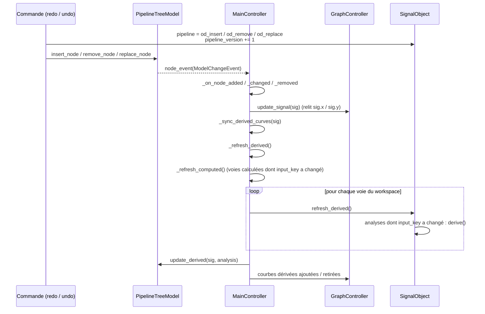

# 02 · Pipeline non destructif

Principe : **les données lues dans un fichier ne sont jamais modifiées**. Tout ce que l'utilisateur applique à une
voie (filtre, décalage, troncature) est un calque, recalculé à la demande à partir des données brutes. On peut donc
toujours annuler, réordonner ou supprimer une modification.

## Les trois étages



1. **Fichier** ([`FileObject`](../../model/base_objects.py)) : période et décalage donnent l'axe des temps, et les
   troncatures donnent la fenêtre d'échantillons conservés. Ces réglages s'appliquent à toutes les voies du
   fichier.
2. **Filtres de la voie** (`SignalObject.pipeline`) : chaque `FilterNode` reçoit le `x` et le `y` produits par les
   précédents et renvoie de **nouveaux** tableaux.
3. **Sorties** : la courbe, les analyses, les voies calculées et le curseur lisent tous `sig.x` / `sig.y`, c'est-à-dire
   les données après filtres.

## `SignalObject.compute()`

```python
raw_x = self.file.get_x()                      # axe tronqué, mis en cache par le fichier
if cache_valide and _cache_version == pipeline_version and _cache_raw_x is raw_x:
    return self._cache
x, y = raw_x, self.file.get_y(self.name)
for node in self.pipeline.values():
    y = node.apply(x, y)
    x = node.apply_x(x)
```

Le cache est valable tant que deux choses n'ont pas changé :

- **`pipeline_version`** : chaque commande qui ajoute, retire ou remplace un filtre l'incrémente ;
- **l'identité de l'axe des temps** (`_cache_raw_x is raw_x`) : changer la période, le décalage ou une troncature du
  fichier crée un nouvel axe (`_rebuild_time` vide le cache `_raw_x`, `window()` est recalculé), donc un nouvel
  objet. Le test d'identité suffit, et il ne coûte rien.

`sig.y` renvoie une copie (`np.array(self.compute())`). `x` est en lecture seule : un filtre qui voudrait modifier
l'axe en place échouerait, ce qui protège l'axe partagé du fichier.

## `FilterNode`

[model/filters/base_filter.py](../../model/filters/base_filter.py) est une classe abstraite. Une sous-classe déclare :

| Attribut / méthode | Rôle |
|---|---|
| `action_type` | Membre de `qSignalType`, identité du filtre (JSON, undo, factory) |
| `PARAMETER_SCHEMA` | Paramètres et valeurs par défaut (voir [01 · Modèle](01-modele-donnees.md)) |
| `validate(params)` | Lève `ValueError` si les paramètres sont incohérents. Appelée par `set_params`, donc dès la construction |
| `apply(x, y)` | Renvoie un nouveau `y` |
| `apply_x(x)` | Renvoie un nouvel axe des temps. Par défaut, `x` est inchangé |
| `display_name` | Libellé dans l'arbre |

Méthodes communes : `get_params()`, `to_dict()` / `from_dict()` et `clone_with(**params)`. Cette dernière crée un
nouveau node avec les paramètres modifiés : c'est ainsi qu'on modifie un filtre (voir
[05 · Undo / redo](05-undo-redo.md)).

### Filtres existants

Ils sont enregistrés dans [`FilterFactory.REGISTRY`](../../model/filters/filter_factory.py) :

| `qSignalType` | Classe | Effet |
|---|---|---|
| `FILTER` | [`LowPassFilter`](../../model/filters/lowpass.py) | Butterworth `filtfilt` (sans déphasage). `fs` suit la période du fichier. Les trous (NaN) sont comblés pendant le filtrage, puis remis |
| `AVG` | [`MovingAverageFilter`](../../model/filters/moving_average.py) | Moyenne glissante des seuls échantillons valides |
| `OFFSET` | [`OffsetFilter`](../../model/filters/offset.py) | `y + offset` |
| `OFFSET_X` | [`TimeShiftFilter`](../../model/filters/time_shift.py) | Ne touche que `apply_x` : décale l'axe des temps de la voie |
| `DIFF` | [`DiffFilter`](../../model/filters/diff.py) | `y − référence`, la référence étant une voie **du même fichier**. Elle est interpolée si les axes diffèrent |

Pour en ajouter un, voir le [guide](guide-ajouter-un-filtre.md).

## Recalcul en chaîne

Après une modification, il faut aussi remettre à jour **ce qui dépend** du signal modifié. Le `MainController` s'en
charge, à la réception du `node_event` émis par le `PipelineTreeModel` à la fin de chaque commande :



### Clés d'invalidation

Le recalcul est **paresseux**. Chaque consommateur compare une clé, prise au moment du calcul, avec la clé actuelle :

| Consommateur | Clé | Calculée par |
|---|---|---|
| Cache du pipeline | `pipeline_version` + identité de l'axe | `SignalObject.compute` |
| Signal dérivé d'une analyse | `input_key()` = `(pipeline_version, *file.time_key())`. Certaines analyses y ajoutent leurs propres dépendances, par exemple la voie de puissance du modèle thermique | `AnalysisNode.input_key`, comparée dans `SignalObject.refresh_derived` |
| Voie calculée | `_source_key()` : `input_key` des voies utilisées, plus la base de temps | `ComputedSignal.base` |
| Courbe d'une voie calculée | `input_key()` mémorisée dans `MainController._computed_keys` | `MainController._refresh_computed` |

Une analyse dont le recalcul échoue perd son signal dérivé. La raison est gardée dans `analysis.error`, avec la clé
`_error_key`, pour ne pas réessayer en boucle avec les mêmes données. Le message s'affiche dans la barre d'état, et l'arbre
ajoute « ⚠ » au nom de l'analyse, avec la raison en infobulle.

### Limite connue

Le cache d'un signal ne suit **pas** sa référence : un `DiffFilter` lit `ref.x` / `ref.y` dans `apply`, mais la clé
de cache du signal filtré ne contient que son propre `pipeline_version`. [model/pipeline.py](../../model/pipeline.py)
prévoit une invalidation des signaux dépendants (`invalidate_signal_and_dependents`), mais elle n'est appelée nulle
part pour l'instant.

## Données manquantes

Les valeurs absentes ou invalides (BURNOUT d'un GL, cellule vide, voie calculée hors de la zone commune) valent
`NaN`. Les filtres et les analyses les excluent ([model/missing_data.py](../../model/missing_data.py) :
`fill_gaps`, `valid_on`). L'affichage les montre par une interruption de la courbe ou par une valeur de
remplacement, selon l'option « Missing data » du graphique (`GraphController._display_y`).
