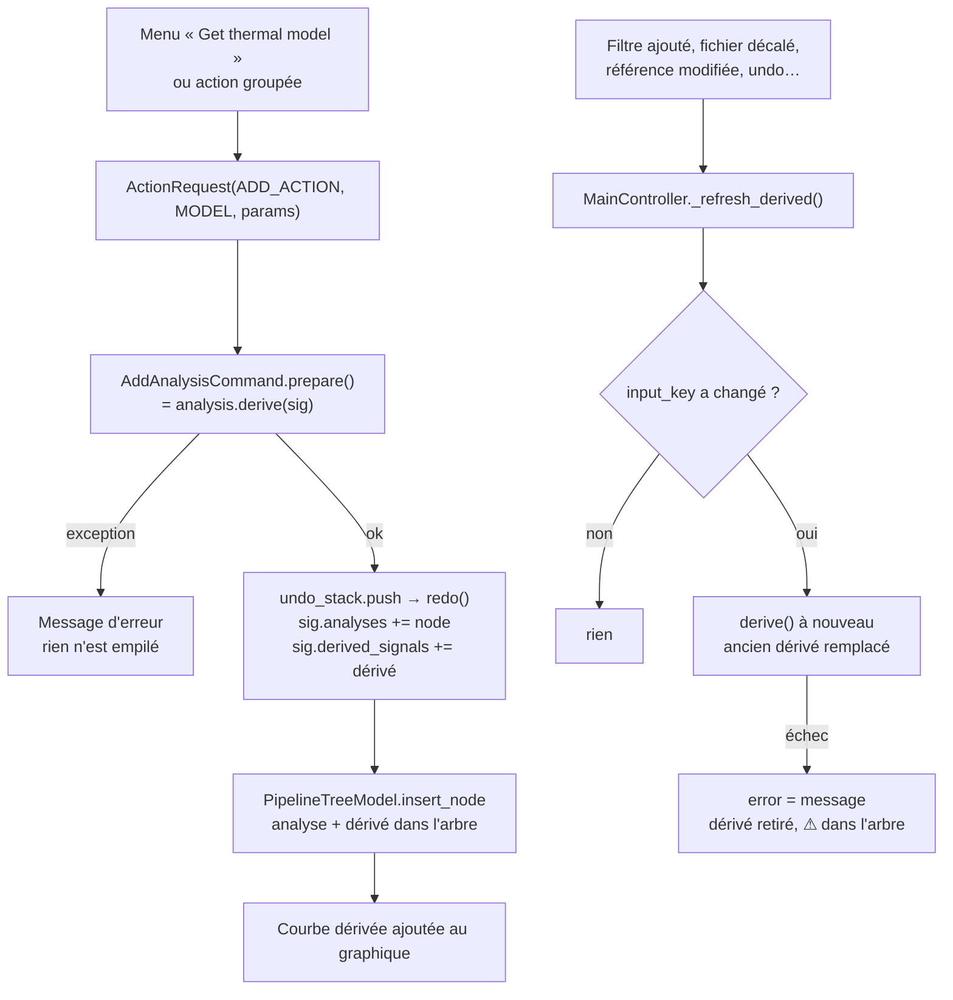
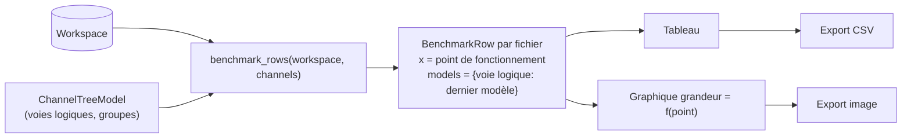

# 03 · Analyses

Un **filtre** transforme la voie elle-même. Une **analyse** laisse la voie intacte et **produit un nouveau signal**,
un `DerivedSignalObject` : la courbe d'un modèle, un spectre, une différence. Ce signal s'affiche sous l'analyse
dans l'arbre et se trace dans le graphique de la voie parente.

## `AnalysisNode`

[model/analysis/base_analysis.py](../../model/analysis/base_analysis.py) est le pendant de `FilterNode` : même
gestion des paramètres (`PARAMETER_SCHEMA`, `validate`, `get_params`, `clone_with`) et même sérialisation
(`to_dict` / `from_dict`). Ce qui change :

| Méthode | Rôle |
|---|---|
| `compute(parent_signal)` | Calcule et renvoie un `DerivedSignalObject` à partir de `parent_signal.x` / `.y`, donc **après les filtres** |
| `derive(parent_signal)` | Appelle `compute`, puis note dans `metadata` l'`analysis_id` et l'`input_key` qui ont servi au calcul |
| `input_key(parent_signal)` | État des données d'entrée. Par défaut, celui du signal parent. On le surcharge quand l'analyse dépend d'un autre signal |
| `display_param(key, sig)` | Valeur affichée dans le ParameterTree, si elle diffère de la valeur stockée |
| `upgrade_params(params)` | Facultatif (méthode statique) : convertit les paramètres d'un ancien projet. Appelée par `AnalysisFactory.create_saved` |

Les attributs `error` et `_error_key` gardent la trace du dernier recalcul en échec (voir
[02 · Pipeline](02-pipeline.md#clés-dinvalidation)).

## Cycle de vie



## Analyses existantes

Elles sont enregistrées dans [`AnalysisFactory.REGISTRY`](../../model/analysis/analysis_factory.py).

### Modèle thermique : `ThermalModelAnalysis` (`MODEL`)

[model/analysis/thermal.py](../../model/analysis/thermal.py) ajuste une réponse du 1er ordre à un échelon de
puissance :

```text
T(t) = T∞ − (T∞ − T0) · exp(−t / τ)          (fonction thermal_step, ajustée par scipy curve_fit)
Rth = (T∞ − T0) / P        Cth = τ / Rth
```

- **Plage d'ajustement** (`model_range`) : on la choisit sur le graphique au moment de la création (`RangePicker`,
  puis `MainController._on_model_range_accepted`), puis on peut la modifier avec les curseurs du ParameterTree.
  Elle est **stockée en temps de l'enregistrement** (`range_origin = 'record'`), pour rester sur les mêmes
  échantillons quand le fichier ou la voie sont décalés (`SignalObject.time_shift()`).
- **Puissance** (`power_channel` / `power`) : soit la moyenne d'une voie sur la plage (souvent une voie calculée
  `steps(time; …)`), soit une valeur saisie. `input_key` y ajoute l'état de la voie de puissance : modifier cette
  voie recalcule le modèle.
- **Résultats** : un `ThermalFitResult` ([custom_items.py](../../ressources/custom_items.py)) avec τ, Rth, Cth, T∞,
  T0, RMSE et la puissance utilisée (moyenne, min, max). Il est affiché dans le ParameterTree
  (`ThermalModelResultParameter`).
- **Courbe modèle** : en pointillé, de la couleur de la voie. Elle est prolongée jusqu'à 5 τ (`N_TAU`) en
  projection automatique, sinon jusqu'à la durée saisie.
- **Garde-fous** : la fonction lève `InvalidModelFit` si la puissance est nulle, si T∞ est incohérent, si τ est
  irréaliste, ou s'il y a moins de 5 points valides.

### FFT : `FFTAnalysis` (`FFT`)

[model/analysis/fft.py](../../model/analysis/fft.py) calcule le spectre d'amplitude (moitié positive) avec une
fenêtre au choix (Hann, Hamming ou rectangulaire). Elle refuse le calcul au-delà d'une certaine proportion de
données manquantes (`MAX_MISSING`).

### Différence entre fichiers : `DiffSignalAnalysis` (`DIFF_EXT`)

[model/analysis/diff_external.py](../../model/analysis/diff_external.py) calcule « Get temperature rise » quand la
référence est dans **un autre fichier**. Le `MainController` choisit automatiquement entre le filtre `DIFF` (même
fichier) et cette analyse (`_build_action_request`). Les deux voies sont interpolées sur une base de temps commune
(méthode `interp` au choix, alignement par le début ou la fin). La référence est sauvegardée par son nom et celui de
son fichier, puis retrouvée à la relecture du projet par `resolve_reference`. `input_key` y ajoute l'état de la
référence.

## Benchmark

La fenêtre « Benchmark » compare **les modèles thermiques d'une même voie dans plusieurs essais**, par exemple la
Rth du dissipateur à 100, 200 et 300 W.



- **Modèle** ([model/benchmark.py](../../model/benchmark.py)) : uniquement des fonctions pures, testables sans Qt.
  - `operating_point(label)` lit le premier nombre de l'étiquette du fichier (« 100 W / 55 °C » donne 100 W).
  - `thermal_model(sig)` renvoie le dernier modèle calculé d'une voie.
  - `QUANTITIES` liste les grandeurs proposées : ΔT, Rth, T∞, τ.
  - `power_text` signale une puissance qui varie de plus de 5 % sur la plage (le modèle est peut-être à cheval sur
    deux paliers).
- **Contrôleur** ([benchmark_controller.py](../../controller/benchmark_controller.py)) : il est créé à la première
  ouverture. Il reçoit une fonction qui renvoie le workspace courant (le workspace change quand on ouvre un
  projet) et le `ChannelTreeModel`. `refresh()` se déclenche à chaque mouvement de la pile undo et à chaque
  reconstruction de la vue « Par voie ».
- **Vue** : [view/benchmark_window.py](../../view/benchmark_window.py).
