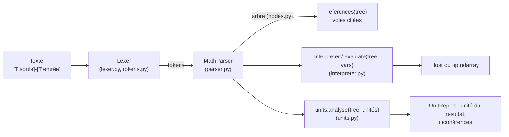
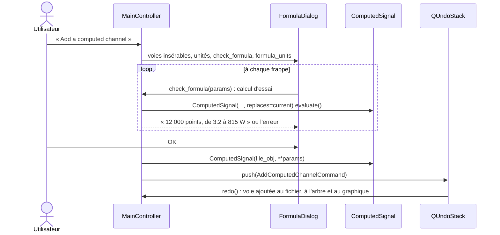

# 04 · Voies calculées

Une **voie calculée** est une voie d'un fichier dont les valeurs viennent d'une formule, au lieu d'être lues dans
le fichier :

```text
[Débit]/60*4180*([T eau sortie]-[T eau entrée])            pertes évacuées par l'eau
steps(time; 0; 200; 201; 800)                               puissance par paliers
[Débit]/60000*rho_water([T entrée])*cp_water([T entrée])*([T sortie]-[T entrée])
```

Elle se comporte **comme une voie mesurée** : on peut la filtrer, l'analyser, la voir dans la vue « Par voie » et la
comparer dans le Benchmark. Seules ses données brutes sont calculées.

## Deux couches

| Couche | Fichiers | Rôle |
|---|---|---|
| Langage de formule | [model/formula/](../../model/formula/) | Analyse et évaluation d'un texte, sans rien savoir de GLviewer |
| Voie calculée | [model/computed.py](../../model/computed.py) : `ComputedSignal(SignalObject)` | Résout les voies citées, choisit la base de temps, met le résultat en cache, le sauvegarde |

### `model/formula` : lexer → parser → interpréteur



- **API publique** ([`__init__.py`](../../model/formula/__init__.py)) : `parse(text)`, `references(tree)`,
  `evaluate(tree, variables)`, `units.analyse(...)` et `FormulaError`.
- **Grammaire** (en tête de [parser.py](../../model/formula/parser.py)) : `+ - * / ^`, fonctions, `[noms entre
  crochets]`, identifiants (`CH3`, `time`). Les arguments sont séparés par `;`.
- **Sémantique numpy** : sur des tableaux, un échantillon invalide donne `nan` / `inf` sans arrêter le calcul. Sur
  des scalaires, une erreur de domaine lève une exception.
- **Fonctions** : `sin`, `cos`, `exp`, `log`, `sqrt`, `abs`, `min`, `max`, `avg`… On y trouve aussi les tables de
  correspondance [`steps` / `interp`](../../model/formula/lut.py) et les propriétés des caloporteurs
  [`rho_water`, `cp_air`…](../../model/formula/fluids.py) (eau de 0 à 100 °C, air sec de −73 à 226 °C, `nan` hors
  de ces plages).
- **Unités** ([units.py](../../model/formula/units.py)) : l'analyse dimensionnelle n'est faite que pour informer.
  Elle vérifie l'homogénéité (°C et K ont la même dimension), mais pas les facteurs numériques (`/60`, `*1000`).
- Le package vient du projet LEXER. Ses tests sont `tests/test_formula_*.py`.

### `ComputedSignal`

- **Désignation des voies** (`_find`) :
  - `[T AMB]` désigne une voie du fichier hôte. La recherche se fait par nom exact, puis sans tenir compte de la
    casse ni des espaces, puis par numéro de voie ;
  - `[200 W:T AMB]` désigne une voie d'un autre fichier, repéré par son étiquette ou son nom ;
  - `CH3` désigne une voie par son numéro ;
  - `time` est le temps en secondes.
- **Base de temps** : `Host file` reprend les échantillons du fichier hôte, troncature et décalage compris.
  `Own period` utilise une période propre, au plus `MAX_POINTS`. Une voie sur une autre base de temps est
  interpolée, et vaut `nan` hors de la zone commune. Une voie plus lente que la base de temps déclenche un
  avertissement.
- **Données d'entrée** : les voies citées sont prises **après leurs filtres** (`sig.x` / `sig.y`).
- **Cache** : `base()` recalcule la formule quand `_source_key()` change. Cette clé contient les paramètres de la
  formule, le `time_key` du fichier hôte, les fichiers présents et l'`input_key` de chaque voie citée. Ensuite,
  `compute()` applique le pipeline de filtres de la voie calculée, comme pour une voie mesurée.
- **Références circulaires** : la liste de module `_computing` les détecte pendant l'évaluation
  (`Circular reference: A -> B -> A`). `depends_on` les refuse dès la saisie.
- **Échec** : la voie vaut `nan` partout, la raison est dans `self.error`, et l'arbre l'affiche (« ƒ nom ⚠ » avec
  une infobulle).

## Du dialogue à la courbe



Pour modifier une voie, `_modify_computed_channel` pousse un `ModifyComputedChannelCommand`. Pour la supprimer,
`_delete_selected_item` pousse un `RemoveComputedChannelCommand`. Après tout changement en amont, par exemple un
filtre sur une voie citée, `MainController._refresh_computed` redessine les voies calculées dont l'`input_key` a
changé.

## Sauvegarde

`to_dict()` ajoute une clé `"computed"` (formule, unité, base de temps, période) au dictionnaire d'une voie
ordinaire. À la relecture, `FileObject.signals_from_dict` reconnaît cette clé et appelle
`ComputedSignal.from_saved`. Les projets plus anciens stockaient la formule comme une analyse `FORMULA` :
`from_formula_analysis` la convertit en voie calculée.
