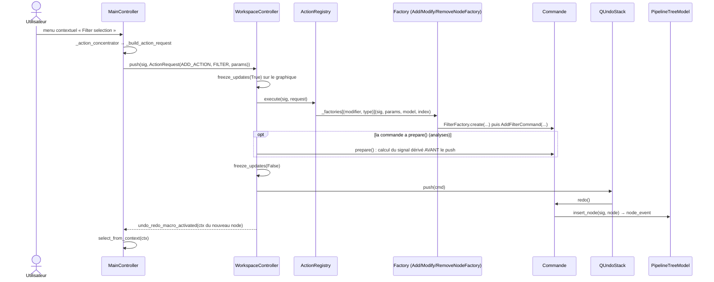

# 05 · Undo / redo

Toute modification que l'utilisateur doit pouvoir annuler passe par **une commande Qt** (`QUndoCommand`), empilée
dans **une seule pile** : `WorkspaceController.undo_stack` ([workspace_controller.py](../../controller/workspace_controller.py)).
Ctrl+Z et Ctrl+Y sont créés par `MainController._init_undo_redo` (`createUndoAction` / `createRedoAction`). Ils
sont partagés avec les fenêtres des graphiques détachés (`graph_ctrl.shared_actions`).

## Deux chemins vers la pile

| Chemin | Pour quoi | Qui construit la commande |
|---|---|---|
| `WorkspaceController.push(sig, ActionRequest)` | Filtres et analyses : ajout, modification, suppression | `ActionRegistry` → factories → `Add/Modify/Remove…Command` |
| `workspace_ctrl.undo_stack.push(cmd)` direct | Tout le reste : fichiers, paramètres de fichier, voies calculées, graphiques, appariement, annotations | `MainController` construit lui-même la commande |

### Chemin 1 : `ActionRequest` → `ActionRegistry`

- **`ActionRequest`** ([custom_items.py](../../ressources/custom_items.py)) contient `action_modifier` (`ADD_ACTION`,
  `MODIFY_ACTION`, `REMOVE_ACTION`), `action_type` (`qSignalType`), `params` et `index`, la **position** du node dans
  le pipeline ou les analyses. Le `WorkspaceController` y ajoute `model`.
- **`ActionRegistry`** ([action_registery.py](../../controller/commands/action_registery.py)) associe chaque couple
  `(modifier, type)` à une factory. Tous les filtres de `FilterFactory` et toutes les analyses d'`AnalysisFactory`
  y sont inscrits par `_init_action_dict`.
- **Erreurs** : la commande est construite et, pour les analyses, calculée (`prepare()`) **avant** le push. Une
  exception levée dans `redo()`, appelé par Qt, serait perdue. En cas d'échec, rien n'est empilé et un message
  s'affiche. `MissingParameters` ouvre un dialogue (`_ask_missing_params`) et relance le push avec les paramètres
  complétés.
- **Gel de l'affichage** : `freeze_updates` coupe le rafraîchissement du graphique pendant la commande. Sans cela,
  l'application plantait (« QPaintDevice: Cannot destroy paint device that is being painted », voir Rev04 dans
  [historique_modifs.txt](../../historique_modifs.txt)).

### Les commandes de nodes

| Commande | `redo()` | `undo()` |
|---|---|---|
| [`AddFilterCommand`](../../controller/commands/add_filter.py) | `od_insert` dans `pipeline`, `pipeline_version += 1`, `model.insert_node` | `od_remove`, `model.remove_node` |
| [`ModifyFilterCommand`](../../controller/commands/modify_filter.py) | `od_replace(ancien → clone)` | `od_replace(clone → ancien)` |
| [`RemoveFilterCommand`](../../controller/commands/remove_filter.py) | `od_remove` | `od_insert` à la même position |
| [`AddAnalysisCommand`](../../controller/commands/add_analysis.py) | `od_insert` dans `analyses`, ajoute le signal dérivé calculé par `prepare()` | Retire l'analyse et ses signaux dérivés (repérés par `analysis_id`) |
| `ModifyAnalysisCommand`, `RemoveAnalysisCommand` | Même principe que pour les filtres | |

Elles héritent de `ReplayableCommand` ([custom_commands.py](../../ressources/custom_commands.py)). Leur principe :
**les nodes sont immuables**. Une modification crée un clone (`clone_with`, qui valide les nouveaux paramètres et
lève une erreur avant le push s'ils sont faux). La commande garde l'ancien et le nouveau node, et les échange.
L'undo n'a donc rien à recalculer ni à « défaire » : il remet simplement l'ancien objet.

### Chemin 2 : commandes construites par le `MainController`

| Commande | Fichier | Annule |
|---|---|---|
| `ModifyFileParamsCommand` | [file_params.py](../../controller/commands/file_params.py) | Période, décalage, troncatures, étiquette d'un fichier. Les passe-bas réglés sur l'ancienne période sont remplacés dans la même commande |
| `RemoveFileCommand` | [remove_file.py](../../controller/commands/remove_file.py) | Retrait d'un fichier. Le `FileObject` est gardé et remis à sa place |
| `Add/Remove/ModifyComputedChannelCommand` | [computed_channel.py](../../controller/commands/computed_channel.py) | Voies calculées |
| `GraphNumberCommand` | [graph_number.py](../../controller/commands/graph_number.py) | Changement de graphique d'une ou plusieurs voies |
| `ChannelLinkCommand`, `ChannelMatchingCommand`, `ChannelGroupsCommand` | [channel_link.py](../../controller/commands/channel_link.py) | Vue « Par voie » : associations, mode d'appariement, groupes |
| `Add/Remove/ModifyAnnotationCommand` | [annotations.py](../../controller/commands/annotations.py) | Textes du graphique |

Ces commandes reçoivent le contrôleur et appellent ses méthodes (`_detach_file` / `_attach_file`,
`_apply_file_params`, `_apply_graph_numbers`…), qui mettent à jour l'arbre, le graphique et les analyses
dépendantes.

## Actions groupées et macros

- **`push_group(signals, build_request, text)`** applique une action à plusieurs voies (vue « Par voie ») entre
  `beginMacro` et `endMacro` : **un seul Ctrl+Z** annule tout. Une voie en échec n'empêche pas les autres. Si rien
  n'a été appliqué, l'entrée vide est retirée de l'historique.
- **Macros** ([macro.py](../../controller/commands/macro.py)) : « Start macro recording » remplit `_macro_buffer`
  avec les `ActionRequest` poussées. « Stop macro recording » demande un nom et crée une `Macro`. `apply_macro`
  rejoue ces requêtes sur un autre signal, en une seule entrée d'historique. Si une action échoue, la macro
  partielle est annulée, puis retirée de la pile (`setObsolete(True)` suivi de `redo()`, une astuce de Qt 6).
  `_flatten_macro_actions` est censé fusionner les actions redondantes, mais il est marqué `#! ne marche pas`.

## Ce qui n'est pas annulable

- Les paramètres d'affichage d'une voie (nom, unité, couleur), appliqués directement par `sig.set_params`.
- La sélection, la visibilité (cases à cocher) et le zoom.
- Le chargement d'un fichier ou d'un projet. `create_workspace` **vide la pile**, qui concernait l'ancien
  workspace.

## Effets de bord connectés à la pile

`undo_stack.indexChanged` est relié à `_refresh_benchmark` (la fenêtre Benchmark suit l'historique) et à
`_update_title` (l'étoile `*` du titre, qui signale un travail non enregistré : `is_modified` compare l'état actuel
du projet `to_dict()` avec celui du dernier enregistrement).
