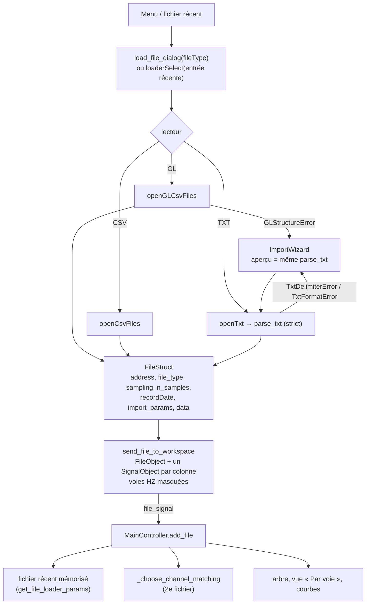

# 06 · Import

Tout se passe dans [`ImportController`](../../controller/import_controller.py), avec l'aide de
[model/txt_import.py](../../model/txt_import.py) pour les fichiers texte et de `ImportWizardDialog`
([custom_dialogs.py](../../ressources/custom_dialogs.py)) pour l'assistant.

## Entrées

| Menu | `fileType` | Lecteur | Pour |
|---|---|---|---|
| « Graphtec .csv formated file » | `GL` | `openGLCsvFiles` | Exports `.csv` des GL820 / GL840, toutes versions de firmware et de logiciel (fichiers testés de 2015 à 2026) |
| « Generic .csv file » | `CSV` | `openCsvFiles` | `.csv` de l'automate du chiller ou de l'étuve : une colonne X par voie, ou une seule |
| « .txt file » | `TXT` | `openTxt`, puis `ImportWizard` en cas de doute | `.txt` / `.csv` quelconques (NTC enregistrées par Matis…) |
| « Project file (.json) » | `JSON` | `openProject` | Projet GLviewer (voir [07 · Projet](07-projet-json.md)) |
| Fichiers récents | celui de l'entrée | `loaderSelect` | Relit le fichier avec les **mêmes réglages** que la dernière fois |

`load_dict` associe chaque `fileType` à un `ImportRequest` (lecteur, libellé, filtre de la boîte de dialogue).

## Chaîne d'import

Un lecteur produit un **`FileStruct`** ([custom_items.py](../../ressources/custom_items.py)), à partir duquel
`FileObject.__init__` copie ses attributs. Le `DataFrame` a un `MultiIndex` (rang, temps).

### Graphtec `.csv` : `openGLCsvFiles`

Les exports GL n'ont pas un format fixe : les lignes vides, les colonnes et les en-têtes varient selon le modèle et
le firmware. Le lecteur ne suppose donc **aucun numéro de ligne** :

1. `csv.Sniffer` détecte le séparateur (`;` ou `,`).
2. Dans les 100 premières lignes, il cherche dans l'ordre les mots-clés de `file_caracs` : `Sampling`,
   `Total data points`, `Trigger time`, `CH`, `Data`.
3. Dans le tableau des voies (entre `CH` et `Data`), il trouve les colonnes `Signal name`, `Span` et `Input` par leur
   en-tête. Il garde, pour chaque voie, son numéro (`CH3`), son nom (rendu unique si besoin), sa plage et son
   unité. Ces informations vont dans `import_params['channel_ids']` et `['channel_units']`.
4. Les valeurs non numériques (`BURNOUT`…) deviennent `NaN` : ce sont des données manquantes.
5. `isChannelValid` repère les voies **HZ** (thermocouple coupé, entrée restée en l'air). Une voie est HZ si moins
   de 90 % de ses points sont dans la plage, ou si elle saute en permanence. Le résultat va dans
   `import_params['check_table']`. Au premier chargement, `hide_invalid_channels` décoche ces voies. À la
   réouverture d'un projet, c'est la visibilité sauvegardée qui s'applique.

L'historique des cas rencontrés est dans [historique_modifs.txt](../../historique_modifs.txt) (Rev05).

### `.txt` et assistant d'import

[`parse_txt(path, settings, default_sampling, strict)`](../../model/txt_import.py) découpe le fichier selon les
réglages de l'assistant :

| Réglage | Sens |
|---|---|
| `delim` | Séparateur de colonnes, ou liste des candidats à détecter (`;,\t` par défaut) |
| `unitdelim` | Séparateur décimal |
| `start` | Première ligne de données |
| `columns` | Colonnes ignorées |
| `sigNames` | La première ligne contient les noms des voies |
| `isFirstColIndex` | La première colonne conservée est le temps. Sinon, la période par défaut s'applique |

- **Premier essai sans assistant** (`strict=True`) : une colonne sans aucune valeur numérique est jugée suspecte (le
  séparateur décimal est sans doute faux). La fonction lève alors `TxtFormatError`, et l'assistant s'ouvre.
- **L'aperçu de l'assistant appelle la même fonction** (`max_rows`) : l'aperçu montre exactement ce que donnera le
  chargement.
- Les réglages retenus sont gardés dans `import_params`. Ils servent pour les fichiers récents et pour relire le
  fichier à l'ouverture d'un projet (Rev07).
- Les voies d'un `.txt` ne sont **pas** testées HZ : leur plage n'est pas connue.

### Gestion des erreurs

`loaderSelect` attrape les exceptions de [custom_exceptions.py](../../ressources/custom_exceptions.py)
(`TxtDelimiterError`, `TxtFormatError`, `CsvStructureError`, `GLStructureError`) et propose l'assistant. Une erreur
inconnue ouvre `ImportErrorDialog`, qui propose d'essayer un autre format. Les erreurs de projet (`JSONImportError`)
ont leur propre message (`_project_error`).

## Mode interactif ou restauration

`_from_project` (`ImportMode.INTERACTIVE` / `RESTORE`) décide de ce que fait un lecteur à la fin :

- **interactif** : il envoie le fichier au workspace (`send_file_to_workspace`, puis `file_signal`) ;
- **restauration** (ouverture d'un projet) : il **renvoie** le `FileStruct` à `_restore_project`, qui construit
  lui-même les `FileObject`.

`openProject` remet le mode interactif dans un `finally` : sans cela, après un projet en échec, plus aucun import
n'arriverait dans le workspace.

## Options d'import

Elles sont lues dans les options utilisateur (`MenuController`, onglet « Import settings » de
[custom_viewer_settings.py](../../ressources/custom_viewer_settings.py)), puis transmises par
`MainController._on_new_settings` → `ImportController.updateOptions` : période par défaut des `.txt` et `.csv`,
séparateurs par défaut, masquage des voies hors plage, dossier d'ouverture, mode d'appariement des voies entre
fichiers…
