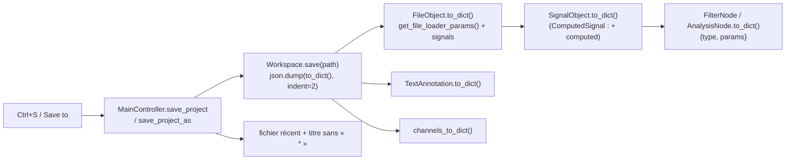
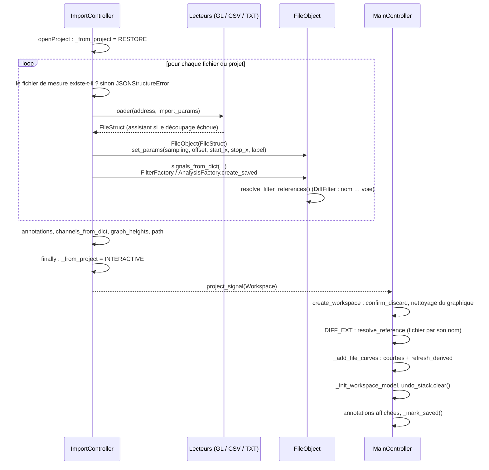

# 07 · Projet `.json`

Un projet **ne contient pas les mesures**. Il contient le chemin des fichiers de mesure, leurs réglages d'import et
tout ce que l'utilisateur a ajouté par-dessus : réglages des fichiers, filtres, analyses, voies calculées,
appariement des voies, annotations, hauteur des graphiques. À l'ouverture, chaque fichier de mesure est **relu** et
le pipeline est reconstruit.

## Enregistrer



## Structure du fichier

```jsonc
{
  "version": "1.0",
  "workspace": {
    "files": [
      {
        "file_type": "GL",                       // nom d'un fileType
        "address": "C:/essais/100W.csv",         // fichier de mesure relu à l'ouverture
        "import_params": { "channel_ids": {}, "channel_units": {}, "check_table": [] },
        "sampling": 1.0, "offset": 0.0, "start_x": 0.0, "stop_x": 0.0,
        "label": "100 W / 55 °C",
        "signals": [
          {
            "id": "3f2a…", "name": "T dissipateur", "unit": "°C",
            "graph_number": 1, "visible": true, "is_reference": false,
            "pen": { "color": "#ff1f77b4", "width": 1.0, "style": 1, "dash": [], "cosmetic": true, "cap": 16, "join": 64 },
            "pipeline": [ ["9c1e…", {"type": "FILTER", "params": {"cutoff": 0.01, "fs": 1.0, "order": 2}}] ],
            "analyses": [ ["b77d…", {"type": "MODEL", "params": {"model_range": [120.0, 5400.0], "range_origin": "record"},
                           "results": {"tau": 812.4, "R_th": 0.21}}] ]   // results : informatif, ignoré à la relecture
          },
          {
            "name": "Pertes eau",
            "computed": { "formula": "[Débit]/60*4180*([T sortie]-[T entrée])", "unit": "W",
                          "time_base": "Host file", "period": 0.001 },
            "pipeline": [], "analyses": []
          }
        ]
      }
    ],
    "annotations": [ { "id": "…", "html": "…", "pos": [600, 45.2], "anchor_pos": null,
                       "color": "#ff000000", "font": "", "graph": 1 } ],
    "channels": { "matching": "name",
                  "links":  [ { "mode": "name", "file": 1, "signal": "T_dissip", "key": "name:t dissipateur" } ],
                  "groups": [ { "name": "Bobinages", "keys": ["…"], "id": "…" } ] },
    "graph_heights": [1.2, 0.8]
  }
}
```

(Les valeurs sont abrégées. Les paramètres exacts des nodes sont ceux de leur `get_params()`.)

Points de format :

- **`pipeline` et `analyses` sont des listes de paires `[id, node]`**. Un `OrderedDict` ne se sérialise pas, et l'id
  doit survivre à l'enregistrement : c'est lui qui relie une analyse à ses signaux dérivés et à sa voie de
  puissance.
- **Les signaux dérivés ne sont pas sauvegardés** : ils sont recalculés à l'ouverture (`refresh_derived`). Les
  `results` d'un modèle thermique sont écrits pour information (exploitation du `.json` hors de GLviewer), mais
  ne sont pas relus.
- **Les références à d'autres voies sont des noms**, pas des objets : la référence d'un `DiffFilter`, le fichier et
  la voie d'un `DiffSignalAnalysis`, la voie de puissance d'un modèle thermique. Dans `channels.links`, une voie est
  repérée par le rang de son fichier et son nom.
- **`QPen`** est converti par `QPen_to_dict` / `dict_to_QPen`
  ([custom_struct_functions.py](../../ressources/custom_struct_functions.py)).

## Ouvrir



Les références entre fichiers ne peuvent être résolues **qu'une fois tous les fichiers chargés**. C'est pourquoi
`resolve_reference` des `DIFF_EXT` est appelé dans `create_workspace`, et non pendant la lecture.

## Compatibilité avec les anciens projets

La relecture accepte les formats précédents. Chaque cas est commenté dans le code :

| Ancien format | Traitement | Où |
|---|---|---|
| Node sans id (`{type, params}` au lieu de `[id, {…}]`) | Un nouvel id est attribué | `SignalObject._split_saved_node` |
| Voie sans `id` ni `unit` | Nouvel id, unité du fichier | `SignalObject.from_dict` / `_restore_nodes` |
| Analyse thermique sans résultat sauvée `{}` | Ignorée | `_restore_nodes` |
| Formule enregistrée comme analyse `FORMULA` | Convertie en voie calculée | `ComputedSignal.from_formula_analysis` |
| Paramètres d'analyse d'une version précédente | `upgrade_params` | `AnalysisFactory.create_saved`, `ThermalModelAnalysis.upgrade_params` |
| Clés absentes (`annotations`, `channels`, `graph_heights`, paramètres de fichier) | Valeurs par défaut | `_restore_project` |

Si tu changes le format, ajoute un cas à ce tableau et un test dans
[tests/test_project_io.py](../../tests/test_project_io.py) ou [tests/test_save_project.py](../../tests/test_save_project.py).

## Travail non enregistré

`MainController.is_modified()` compare `json.dumps(workspace.to_dict(), sort_keys=True)` avec l'instantané pris au
dernier enregistrement (`_mark_saved`). Le titre affiche alors « * », et `confirm_discard` propose d'enregistrer
avant de fermer l'application ou d'ouvrir un autre projet. Charger un fichier de mesure dans un projet non modifié
ne le marque pas comme modifié.

## Code mort

`Workspace.load` ([base_objects.py](../../model/base_objects.py)) appelle `FileObject.from_dict`, qui n'existe pas.
La vraie relecture est `ImportController._restore_project`.
