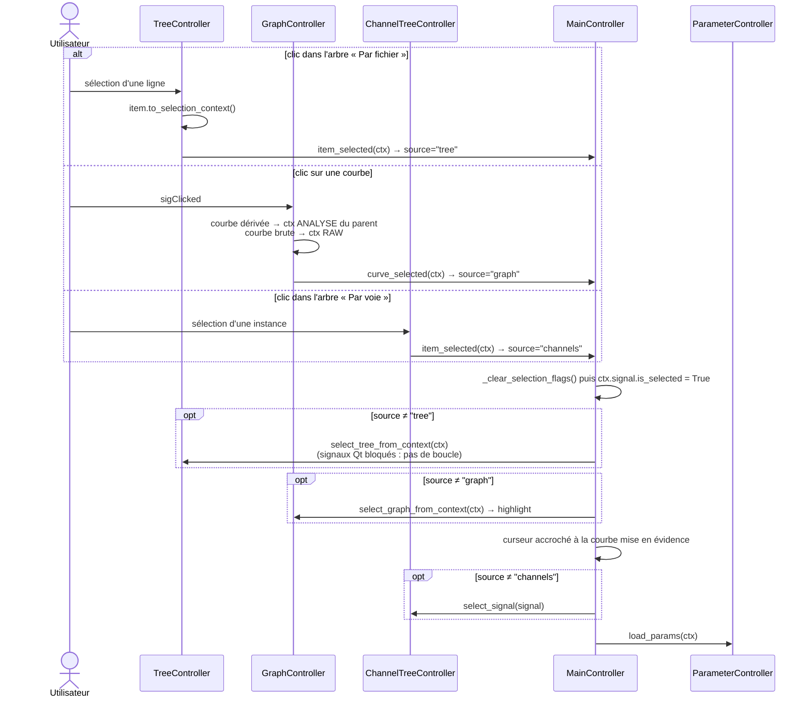
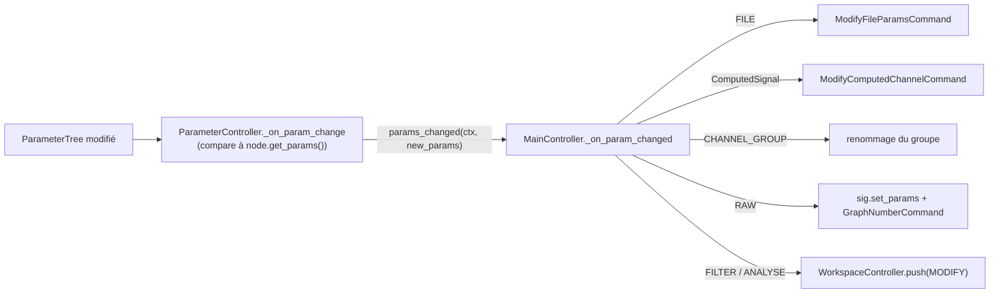

# 08 · Arbres et sélection

Le panneau de gauche a deux onglets, deux façons de voir **le même `Workspace`** :

| Onglet | Modèle Qt | Contrôleur | Organisation |
|---|---|---|---|
| « Par fichier » (`view.treefile`) | [`PipelineTreeModel`](../../model/tree_model.py) | [`TreeController`](../../controller/tree_controller.py) | Fichier → voies → filtres, puis analyses → signaux dérivés |
| « Par voie » (`view.treechannels`) | [`ChannelTreeModel`](../../model/channel_tree_model.py) | [`ChannelTreeController`](../../controller/channel_tree_controller.py) | Groupe (facultatif) → voie logique → une instance par fichier |

Les deux modèles héritent de `QAbstractItemModel` et utilisent des [`TreeItem`](../../model/tree_item.py) (voir
[01 · Modèle](01-modele-donnees.md)). Ils ne copient rien : chaque nœud pointe directement vers l'objet du modèle
(`item.obj`).

## Arbre « Par fichier » : `PipelineTreeModel`

```text
Workspace (racine invisible)
└── FileObject             essai_100W.csv *
    ├── SignalObject       T dissipateur *        ← « * » : au moins un filtre
    │   ├── FilterNode     LowPass (fc=0.01Hz, order=2)
    │   ├── FilterNode     Offset(-0.3)
    │   └── AnalysisNode   Thermal Model (RC_step)
    │       └── DerivedSignalObject  T dissipateur (model RC)
    └── ComputedSignal     ƒ Pertes eau
```

- **Colonnes** : 0 = nom, icône et case de visibilité ; 1 = valeur au curseur (`cursor_values`, recalculées par
  `updateCursorVal`) ; 2 = numéro du graphique (`GRAPH_COLUMN`).
- **Construction** : `_build_tree()` crée tout l'arbre à partir du workspace. Ensuite, l'arbre est mis à jour **par
  petites touches**, avec les `beginInsertRows` / `endInsertRows` de Qt : `add_file_subtree`, `insert_signal`,
  `remove_file_subtree`, et pour les nodes `insert_node`, `remove_node`, `replace_node`, `update_derived`. Les
  commandes undo/redo appellent ces méthodes.
- **`node_event`** : après chaque modification de node, le modèle émet un `ModelChangeEvent(action, context)`. Le
  `MainController` s'en sert pour rafraîchir les courbes et le ParameterTree (voir [02 · Pipeline](02-pipeline.md)).
- **Pas de cache de `QModelIndex`** : Qt déconseille de les garder. `signal_index(sig)`, `find_item` et
  `find_item_by_object_id` les retrouvent en parcourant l'arbre.
- **Glisser-déposer** : `mimeData` met les id des voies glissées dans `GRAPH_SIGNALS_MIME`. Les lâcher sur un
  graphique change leur numéro de graphique (voir [09 · Graphiques](09-graphiques-annotations.md)).

## Arbre « Par voie » : `ChannelTreeModel`

Il sert à comparer **une même voie d'un essai à l'autre** (T dissipateur à 100, 200 et 300 W). La logique est dans
[model/channels.py](../../model/channels.py) :

- **Voie logique** (`ChannelGroup`, `itemType.CHANNEL`) : les voies de plusieurs fichiers qui partagent une clé
  d'appariement.
- **Appariement automatique** (`Workspace.channel_matching`) :
  - `"name"` : même nom, sans tenir compte de la casse, des espaces ni des tirets bas (`channel_key`) ;
  - `"channel"` : même numéro de voie du GL (`CH3` avec `CH3`), ou même colonne pour un `.csv` / `.txt`.

  Le mode est demandé au chargement du 2e fichier, sauf si l'option « Channel matching between files » le fixe.
- **Associations manuelles** (`Workspace.channel_links[mode][sig] = clé`) : on les fait par glisser-déposer d'une
  voie sur une voie logique, ou par le menu contextuel. Elles passent avant l'appariement automatique, et chaque
  mode a les siennes. `solo_key` met une voie à part.
- **Groupes** (`UserGroup`, `itemType.CHANNEL_GROUP`) : des ensembles de voies logiques créés par l'utilisateur
  (« Bobinages » = BOB PH1, PH2, PH3). Un filtre ou une analyse s'y applique **en une fois** : `apply_to_signals`
  passe par `WorkspaceController.push_group`, ce qui fait une seule entrée d'historique.
- **Reconstruction** : `rebuild()` refait tout l'arbre (`beginResetModel`) à chaque changement de structure
  (fichier ajouté, appariement, groupes). C'est simple et suffisant, car l'arbre reste petit. `refresh()` ne
  redessine que les valeurs.

Les modifications de l'appariement et des groupes sont annulables : `ChannelLinkCommand`, `ChannelMatchingCommand`
et `ChannelGroupsCommand` ([controller/commands/channel_link.py](../../controller/commands/channel_link.py)).

## `SelectionContext`

Une dataclass figée ([custom_items.py](../../ressources/custom_items.py)) qui décrit **ce qui est sélectionné**,
quelle que soit la vue d'où vient la sélection :

| Champ | Contenu |
|---|---|
| `role` | `itemType` de l'élément sélectionné (`FILE`, `RAW`, `FILTER`, `ANALYSE`, `DERIVED`…) |
| `signal` | Le signal concerné. Pour un filtre ou une analyse, c'est le signal parent. Pour `FILE`, c'est le `FileObject` |
| `filter_id` / `analysis_id` | Le node visé. Les deux ne peuvent pas être renseignés en même temps |
| `item` | Le `TreeItem` d'origine, s'il y en a un (`None` pour un clic sur une courbe ou un undo) |

`get_node()`, `get_filter()` et `get_analysis()` retrouvent le node par son id dans le signal.

## Flux de sélection

`MainController.select_from_context(ctx, source)` est **l'unique point d'entrée**. L'argument `source` évite de
renvoyer la sélection à la vue d'où elle vient :



Points délicats :

- `select_tree_from_context` **bloque les signaux** du `selectionModel` (`blockSignals`). Sans cela, sélectionner
  l'arbre depuis le graphique réémettrait `item_selected`, et `select_from_context` serait appelé deux fois
  (voir Rev06 dans [historique_modifs.txt](../../historique_modifs.txt)).
- Cliquer sur une **courbe dérivée** sélectionne l'**analyse** qui l'a produite (`metadata['analysis_id']`) : ce sont
  ses paramètres qui s'affichent.
- Après l'ajout d'un filtre ou d'une analyse, c'est **le node** qui est sélectionné, pas le signal : le
  `WorkspaceController` émet `undo_redo_macro_activated` avec un contexte `FILTER` ou `ANALYSE`.
- Un groupe de la vue « Par voie » n'a pas de signal : `group_selected` charge directement ses paramètres (nom,
  graphique) dans le ParameterTree.

## Du ParameterTree au modèle



Remarque : les paramètres d'affichage d'une voie (nom, unité, couleur) sont appliqués directement par
`sig.set_params`. Seul le changement de graphique passe par une commande annulable.
