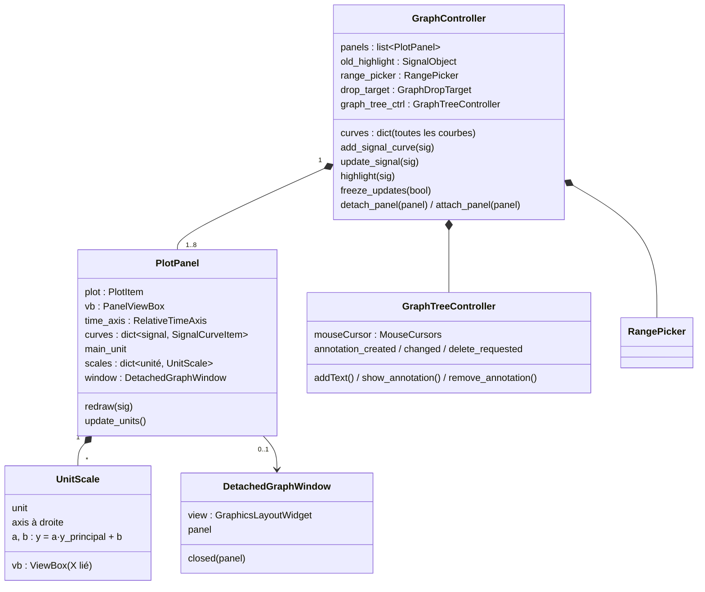
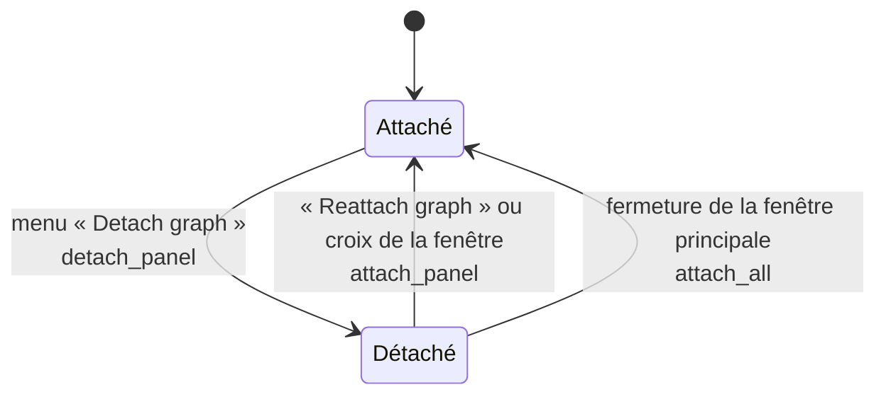
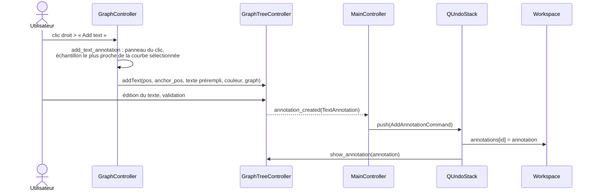

# 09 · Graphiques et annotations

## Organisation

- [`GraphController`](../../controller/graph_controller.py) pilote le `GraphicsLayoutWidget` de la fenêtre
  principale (`view.maingraph`).
- [`PlotPanel`](../../controller/plot_panel.py) est **un graphique empilé** : son `PlotItem`, ses axes et ses courbes.
  Tous les panneaux partagent l'axe des temps.
- [`GraphTreeController`](../../controller/graph_option_controller.py) gère l'arbre des options du graphique
  (`view.graphTree`), le curseur souris et les textes.

## Graphiques empilés

- Chaque voie est tracée dans le panneau n° `graph_number` (1 = en haut). Il y a autant de panneaux que le **plus
  grand numéro utilisé** par une courbe ou un texte, avec un maximum de `MAX_GRAPHS` = 8 (`panel_number` crée les
  panneaux manquants, `trim_panels` retire ceux qui ne servent plus). Les signaux dérivés suivent le panneau de
  leur parent.
- On change de graphique de trois façons : par le paramètre « Graph » d'une voie, d'un fichier ou d'un groupe (pour
  ces deux derniers, toutes leurs voies changent), ou par glisser-déposer depuis un arbre vers un graphique
  (`GraphDropTarget`, puis `signals_dropped`). Dans tous les cas, c'est une `GraphNumberCommand`, donc un seul
  Ctrl+Z (voir [05 · Undo / redo](05-undo-redo.md)). Le dépôt sous le dernier graphique en crée un nouveau.
- **Hauteurs** : on les règle avec les poignées entre les panneaux (`PanelSplitter`, `drag_splitter`). Elles sont
  émises par `heights_changed` et sauvegardées dans `Workspace.graph_heights`.
- **Une échelle par unité** : l'unité principale est à gauche. Chaque autre unité a sa propre ViewBox et son axe à
  droite (`UnitScale`), reliés à l'échelle principale par une relation affine. Zoomer déplace toutes les courbes
  ensemble, et glisser sur un axe de droite ne change que son échelle.
- **Performance** : `setClipToView(True)` et la décimation (« downsample ») ne dessinent que les points visibles.
  `freeze_updates` coupe le rendu pendant les commandes lourdes. La souris est lue au plus toutes les 20 ms
  (`SignalProxy`, `rateLimit=50`).

## Fenêtres détachées

- `detach_panel` retire le `PlotItem` de la fenêtre principale et le place dans une
  [`DetachedGraphWindow`](../../view/detached_graph_window.py). Quand tous les graphiques sont détachés, un texte
  les remplace dans la fenêtre principale.
- **Les fenêtres ne sont jamais détruites** : `_free_window` les masque et les met de côté (`_free_windows`), et
  `_take_window` les réutilise. pyqtgraph (`TextItem.paint`) garde une référence à la scène précédente : la
  détruire ferait planter le prochain dessin d'un texte.
- La croix de la fenêtre est **refusée** (`event.ignore()`) : la fenêtre émet `closed(panel)` et le contrôleur
  réintègre le graphique.
- Ctrl+Z, Ctrl+Y, Ctrl+S et « Save to » restent actifs dans ces fenêtres : `shared_actions`, ajoutées par
  `window.addActions`.
- **Souris centralisée** : `_register_scene` connecte une seule fois chaque scène (fenêtre principale ou détachée)
  au curseur, au clic droit (position des actions du menu) et au `RangePicker`.

## Sélection, surbrillance, curseur

- `highlight(sig)` épaissit la courbe sélectionnée et garde la précédente dans `old_highlight`. Le graphique actif
  (`active_panel`) devient celui de cette courbe.
- **Curseur souris** (`mouseCursor`, un groupe `MouseCursors` de [custom_parameters.py](../../ressources/custom_parameters.py)) :
  `_on_mouse_moved` émet `cursor_moved_X`, et le `MainController` en tire la valeur de chaque voie au curseur
  (colonne 1 des arbres). Avec « snap to selected signal », le curseur s'accroche à la courbe sélectionnée
  (`CursorController`, `sig.nearest_value`).
- **`RangePicker`** : sélection d'une plage sur le graphique, pour la plage d'ajustement d'un modèle thermique.
  Entrée ou double-clic valide, Échap annule.
- **Recalage dans le temps** ([`AlignmentController`](../../controller/alignment_controller.py), « Align in
  time… ») : un bandeau et des poignées sur le graphique. Le décalage du fichier est appliqué par une
  `ModifyFileParamsCommand`.

## Annotations (textes)

- [`TextAnnotation`](../../model/annotations.py) est une dataclass **figée** : texte HTML, position, point annoté
  (relié par une flèche), couleur, police, numéro de graphique, id. Une modification crée une nouvelle instance
  de même id (`with_changes`). La commande garde l'ancienne et la nouvelle, comme pour les nodes.
- Le modèle (`Workspace.annotations`) est la référence. La vue est reconstruite à partir de lui
  (`show_annotation`, `remove_annotation`, `clear_annotations` à l'ouverture d'un projet).
- Le texte annote l'échantillon le plus proche de la courbe sélectionnée, avec sa valeur préremplie (« T dissipateur
  / 85.20 °C @ 3600 s »). Sans courbe sélectionnée, c'est un texte libre.
- En thème sombre, le texte noir s'affiche en clair. `theme.annotation_html` et `stored_annotation_html` font la
  conversion dans les deux sens, pour que le fichier enregistré ne dépende pas du thème (voir
  [10 · Thème](10-theme.md)).
