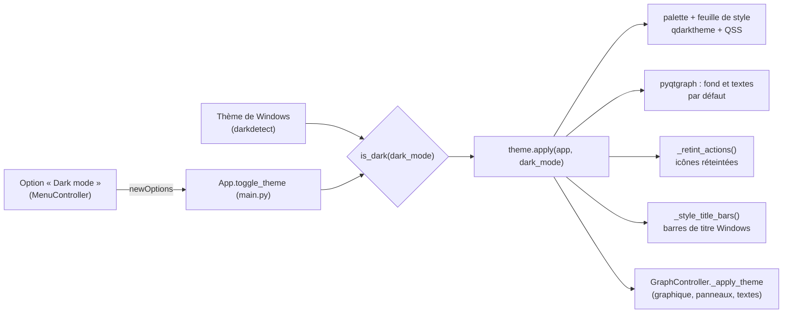

# 10 · Thème

Tout le style passe par **un seul module**, [ressources/theme.py](../../ressources/theme.py). Il s'appuie sur
[pyqtdarktheme](https://github.com/5yutan5/PyQtDarkTheme) (`qdarktheme`) pour la base des widgets. Pas de couleur
codée en dur ailleurs : on appelle `theme.colors()[…]` ou `theme.color(nom)`.

## Choix du thème

Le thème sombre s'applique si l'option « Dark mode » est cochée. Sinon, **le thème suit celui de Windows**
(`darkdetect`). `main.py` installe d'abord le style de base de qdarktheme, puis applique le thème complet dès que
les options sont lues (`newOptions`).

## Jetons de couleur

`LIGHT` et `DARK` ont les mêmes clés :

| Jeton | Usage |
|---|---|
| `window`, `panel`, `header` | Fonds : fenêtre, panneaux, en-têtes de colonnes |
| `text`, `muted` | Texte, texte secondaire et icônes |
| `border` | Bordures et séparateurs |
| `accent`, `highlight` | Couleur d'accent (sélection, cible de dépôt), fond de survol |
| `danger` | Signal de référence dans l'arbre |
| `graph_bg`, `graph_axis`, `graph_text` | Graphique pyqtgraph |

`QSS` complète la feuille de style de qdarktheme (barre d'outils plate, en-têtes discrets…). Ses `{jetons}` sont
remplis par `str.format`. `_qdarktheme_colors` fait correspondre nos jetons aux couleurs de qdarktheme.

## Fonctions utiles

| Fonction | Rôle |
|---|---|
| `colors(dark=None)` / `color(nom)` | Couleurs du thème courant, en dictionnaire ou en `QColor` |
| `icon(nom, tint=None)` | Icône `ressources/icons/<nom>.svg`, dessinée au trait en `currentColor`, teintée à la couleur du thème ou à celle d'une voie (arbres). Mise en cache |
| `set_action_icon(action, nom)` | Icône d'une action, réteintée automatiquement au changement de thème |
| `graph_background(couleur_option)` | Fond du graphique : celui du thème si l'utilisateur n'a pas changé l'option |
| `style_plot(plot_item)` | Axes et textes d'un `PlotItem` aux couleurs du thème |
| `row_tint(couleur)` | Fond très atténué d'une ligne de voie dans les arbres, à la couleur de la voie |
| `annotation_html` / `stored_annotation_html` (et `…_color`) | Texte noir des annotations affiché en clair en thème sombre. **Le projet enregistre toujours le noir** |
| `style_title_bar(widget)` | Barre de titre Windows aux couleurs du thème |

## Barre de titre Windows

C'est Windows (DWM) qui dessine la barre de titre, pas la feuille de style Qt. Plutôt que de passer en fenêtre sans
cadre (il faudrait alors refaire le déplacement, le redimensionnement, l'ancrage et l'ombre), `style_title_bar`
demande à DWM (`DwmSetWindowAttribute`) :

- le mode sombre de la barre (attribut 20, ou 19 sur les anciens Windows 10) ;
- les couleurs de la barre, du titre et de la bordure (Windows 11 seulement ; Windows 10 ignore la demande).

Un filtre d'événements (`_TitleBarFilter`) l'applique à chaque fenêtre qui s'affiche : fenêtre principale,
Benchmark, dialogues, graphiques détachés. Pour une fenêtre déjà affichée, un double `WM_NCACTIVATE` force
Windows à redessiner la barre.

## Ajouter une couleur ou une icône

- **Couleur** : ajoute le jeton dans `LIGHT` **et** dans `DARK` (aucun test ne vérifie que les deux ont les mêmes
  clés), puis lis-le par `theme.colors()["jeton"]`. Les tests du thème sont dans
  [tests/test_theme.py](../../tests/test_theme.py).
- **Icône** : dépose un SVG au trait dans [ressources/icons/](../../ressources/icons/), tracé avec
  `stroke="currentColor"`, puis appelle `theme.icon("nom")` ou `theme.set_action_icon(action, "nom")`.

Le travail en cours sur le style est sur la branche `ui/picoscope-style` (worktree `GLviewer-ui`).
